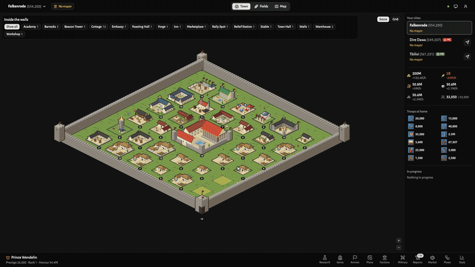

# Marchlands

A browser strategy game in the tradition of **Evony (Age 1)**: build a city, train an army, raise heroes, trade on the market and fight your way up the map to the historic cities, set in the Empire's borderlands around 950–1250.

It started as a from-scratch TypeScript rewrite of the original game server and has since grown rules of its own (every one listed in [docs/deviations.md](docs/deviations.md)). It is based on the open-source C++ server *Spitfire* ([sonya75/evony-private-server](https://github.com/sonya75/evony-private-server)) and the Age 1 battle calculator ([sonya75/EvonyAge1BattleCalc](https://github.com/sonya75/EvonyAge1BattleCalc)). Every formula the original had is ported exactly, and the battle simulator matches all 36,567 regression cases of the original calculator. Where the original left something unbuilt (attacks, transport, reinforcement, the market, quests, friends, alliance permissions and more), Marchlands builds it, following Evony Age 1.

**Status: v0.5, player versus environment.** Players fight barbarian cities, valleys and the historic cities, not each other: attacking and scouting other players is built but switched off (`FEATURE_PVP`, see [Configuration](#configuration)).



## Contents

- [What's in the game](#whats-in-the-game)
- [Play it on your own computer](#play-it-on-your-own-computer) (Docker only, about 10 minutes)
- [Host it for other players](#host-it-for-other-players)
- [Develop it](#develop-it) (Node, hot reload, tests)
- [Configuration](#configuration)
- [Troubleshooting](#troubleshooting)
- [Using the API directly](#using-the-api-directly)
- [How the code is organised](#how-the-code-is-organised)
- [More stacks and moving machines](#more-stacks-and-moving-machines)
- [Documentation](#documentation)
- [Credits](#credits)

## What's in the game

- **Your town and fields**, drawn as animated isometric pixel art: smoke from the chimneys, sails turning, day and night, and weather (rain, snow, storms) shared by everyone in a state. Build and upgrade 20 kinds of building in 32 town slots and 40 fields.
- **The world map**: an 800×800 map that wraps at the edges, with valleys to hold, barbarian cities to raid and 2,081 historic cities standing in their own places. Drag, zoom and jump to any coordinates; your valleys, your farming targets and other players are outlined.
- **The military**: train twelve kinds of troop and five kinds of fortification, send armies to attack, scout, reinforce, carry resources or found a new city, read full battle reports, and plan waves that land on one target in the same second.
- **Heroes**: hire them at the Inn, level them up, spend their points, make one your city's mayor, and equip them with fourteen pieces of gear that grow more splendid with every gear level, shown on an animated 3D (or 2D) figure.
- **Historic cities**: capture level 12, 14, 16 and 18 seats from the factions that hold them. A held seat drafts troops from the barbarian cities in its area, pays tribute, and the capitals and Atlantis bring titles and a share of market fees.
- **Research and items**: a research tree, and over fifty items (speed-ups, production boosts, banners, charters, hero books, medals), each with its own icon.
- **The market and the factions**: an order book with price charts, a merchant, and five NPC factions that trade with you, at prices your standing with them sets.
- **Flows**: a series of actions run on any of your cities at once (build, train, send), with waits between them.
- **Reports and statistics**: every battle, scout and delivery, and charts of how your cities grow.
- **Five languages**: British and American English, Japanese, Arabic (right to left) and Spanish. Light and dark themes and four font styles. It plays on phones, tablets and desktops.

The server also has alliances, quests, rankings, chat and mail, which the browser client doesn't show yet ([TODO.md](TODO.md)). It speaks REST and JSON (with interactive OpenAPI docs) and pushes live updates over a WebSocket, so other clients can be written in anything.

## Play it on your own computer

The quickest way to try the game: everything runs in Docker, and nothing else needs installing.

### 1. Install what it needs

- **[Docker Desktop](https://www.docker.com/products/docker-desktop/)** on macOS or Windows, or Docker Engine with the Compose plugin on Linux. Compose 2.24 or later: check with `docker compose version`.
- **Git**, to fetch the code.
- About 4 GB of free memory while the images build, and 5 GB of disk.

On Windows, run the commands below in WSL 2 (Ubuntu), with the repository cloned inside WSL rather than on the Windows drive: it builds much faster there.

### 2. Get the code and its settings

```bash
git clone <repository-url> marchlands
```

```bash
cd marchlands
```

```bash
cp .env.example .env
```

`.env` holds the ports and settings. The defaults work as they are. For a quicker game, set `GAME_SPEED=50` in it: every timer, production and march goes 50 times faster.

### 3. Start it

```bash
docker compose up -d --build
```

The first build takes a few minutes. Compose then starts, in order:

1. `postgres`, the database;
2. `migrate`, which sets up the database and exits;
3. `worker`, the game clock, which creates the world on first start (a few seconds);
4. `api`, the game server;
5. `web`, the browser client.

Check that everything is up:

```bash
docker compose ps
```

`postgres`, `api` (healthy), `worker` and `web` should be running, and `migrate` should have exited with code 0.

### 4. Play

Open **http://localhost:8000** and sign up. The sign-up form solves a small puzzle in the browser (about half a second) to keep bots out. Then choose your name, your city's name, a flag and the state to start in.

**The first account ever registered becomes an operator** (an administrator), and so does any username listed in `ADMIN_USERNAMES`. Operators can grant items and resources through the API (see [Using the API directly](#using-the-api-directly)).

Other addresses:

| What | Where |
|---|---|
| The game | http://localhost:8000 (`WEB_PORT`) |
| The API | http://localhost:3000/api/v1 (`API_PORT`) |
| Interactive API docs | http://localhost:3000/docs |
| A database browser (optional) | `docker compose --profile tools up -d adminer`, then http://localhost:8080 (server `postgres`, user and password from `.env`) |

### 5. Stop, restart, update and reset

| To | Run |
|---|---|
| Stop the game (it keeps everything) | `docker compose stop` |
| Start it again | `docker compose up -d` |
| Follow the server's logs | `docker compose logs -f api worker` |
| Update to the latest code | `git pull`, then `docker compose stop api worker`, then `docker compose up -d --build` |
| Change a setting in `.env` | `docker compose up -d` (recreates the services whose settings changed) |
| Start a new world from scratch | `docker compose down -v`, then `docker compose up -d` (**deletes every player and city**) |

When updating, stopping `api` and `worker` first lets `migrate` apply any new database changes before the new code starts.

## Host it for other players

[docs/deployment.md](docs/deployment.md) is the full guide to running Marchlands on a server: the machine it needs, a production `.env` with generated secrets, HTTPS with automatic certificates (Caddy), backups, updates, rolling back, day-to-day operations, a security checklist and troubleshooting.

In short, on a Linux server with Docker:

```bash
cp .env.production.example .env    # then fill in the secrets it asks for
docker compose up -d --build       # .env makes Compose use docker-compose.prod.yml too
```

Register your own account before anyone else, so yours is the first operator.

## Develop it

### What you need

- **Node 24** or later (`node -v`). npm comes with it.
- **Docker**, for Postgres (and for the full stack).
- Optional: [act](https://nektosact.com/), to run the CI workflow locally (`npm run ci:local`).

### Set up

```bash
npm install
```

```bash
cp .env.example .env
```

### Run it

Two ways, depending on what you're changing:

**The whole stack in Docker** (as a player sees it). Rebuild the services you changed:

```bash
docker compose up -d --build api worker web
```

If your change adds a database migration, stop `api` and `worker` first (`docker compose stop api worker`), so `migrate` runs before they start.

**From the sources, with hot reload.** Run Postgres in Docker and the rest on your machine, each in its own terminal:

```bash
docker compose up -d postgres
```

```bash
npm run db:migrate
```

```bash
npm run dev:worker
```

```bash
npm run dev:api
```

```bash
npm run dev:web
```

The client is then at http://localhost:5173 (Vite), proxying `/api` and `/ws` to the API on `API_PORT`. The API and worker restart when their code changes, and the client reloads in place. They read `DATABASE_URL` from `.env`, so its port must match `POSTGRES_PORT`.

### Check your work

Before finishing any change, these must all pass:

```bash
npm run typecheck
```

```bash
npm run lint
```

```bash
npm test
```

```bash
npm run format:check
```

And when the change touches the backend, the service tests against a real Postgres (they need the `postgres` container running, and use their own `marchlands_test` database beside the game's):

```bash
npm run test:db
```

`npm run ci:local` runs everything CI runs, in clean Linux containers (about 2 minutes, needs act and Docker).

### Common tasks

| To | Do |
|---|---|
| Change an API route or a contract in `shared/contracts` | `npm run gen:api`: regenerates the OpenAPI spec, the typed client and `docs/api-endpoints.md`; then `npm run typecheck` shows every caller that no longer fits |
| Change the database schema | edit `backend/packages/db/src/schema.ts`, then `npm run db:generate` to write the migration |
| Change a tunable number | `BALANCE` in `shared/core/src/balance.ts`; a rule that differs from the original also goes in `docs/deviations.md` |
| Add or change text a player reads | every locale's file in `client/web/src/locales/` (AGENTS.md, Translations) |
| Redraw the pixel art | `npm run art:draw` (all) or `npm run art:draw -- cottage` (one), then `npm run format` |
| Run a battle simulation | `npm run sim -- …` ([docs/battle-sims](docs/battle-sims/README.md)) |
| Check the client's size | `npm run build:web` (fails over the budget in `client/web/.size-limit.js`) |
| Run end-to-end checks against a running stack | `API=http://localhost:3000 node tools/smoke/smoke.mjs` (also `war.mjs`, `market.mjs`, `abandon.mjs`, `pvp-off.mjs`) |
| Load-test a running stack | `API=http://localhost:3000 npm run load -- --players 100 --minutes 5` |
| Delete test accounts | `npm run delete-player -- <username>…` lists what it would delete; add `--yes` to delete |
| Rebuild the game data from the original dumps | clone [evony-private-server](https://github.com/sonya75/evony-private-server) next to this repository, then `npm run legacy:convert -- ../evony-private-server/DB` |

The smoke and load tests create players: name temporary accounts `fx_…` and delete them with `npm run delete-player` afterwards. Most smoke tests want `GAME_SPEED` of 50 or more and an operator (`ADMIN_USERNAMES=smoke_admin`).

**[AGENTS.md](AGENTS.md) holds the project's conventions**: formatting and lint rules, how the client's components are laid out, translations, server messages, tests, the database and the game art. Read it before a first change.

## Configuration

Settings live in `.env` (template: [.env.example](.env.example)). After changing one, run `docker compose up -d`. The server's full list, with the production-only settings, is in [docs/deployment.md](docs/deployment.md#configuration).

| Variable | Default | What it does |
|---|---|---|
| `POSTGRES_USER` / `POSTGRES_PASSWORD` / `POSTGRES_DB` | `marchlands` | the database's credentials |
| `POSTGRES_PORT`, `API_PORT`, `WEB_PORT` | 5432, 3000, 8000 | ports on your computer |
| `DATABASE_URL` | – | the database, for what runs outside Docker (`dev:api`, `dev:worker`, `test:db`, the tools) |
| `JWT_SECRET` | `change-me-in-production` | signs login tokens; changing it logs everyone out |
| `JWT_TTL` | 604800 | how long a login lasts, in seconds (7 days) |
| `GAME_SPEED` | 1 | multiplies the speed of every timer, production and march; 1 is the original pace |
| `FEATURE_PVP` | `false` | `true` lets players attack and scout each other ([docs/architecture.md](docs/architecture.md#feature-flags)); no rebuild needed, only `docker compose up -d api worker` |
| `WORLD_MAP` | `generated` | on first start: a procedural map (`generated`) or the original's layout (`legacy`) |
| `WORLD_SEED` | `marchlands` | the procedural map's seed |
| `ADMIN_USERNAMES` | – | comma-separated usernames that are operators |
| `CORS_ORIGIN` | any | the browser origins allowed to call the API directly |
| `LOG_LEVEL` | `info` | how much the server logs (`trace` … `fatal`) |
| `WEB_DEV_PORT`, `API_PROXY` | 5173, `http://localhost:$API_PORT` | the Vite dev server's port and where it sends API calls |
| `WORKER_BATCH`, `WORKER_IDLE_MS` | 50, 250 | timed events the worker takes per round, and its pause when none are due |
| `STATS_FLUSH_MS` | 300000 | how often player statistics are written |

The game's own numbers (costs, timers, battle values) are in `shared/core/src/balance.ts`: values marked `(orig)` come from the original server, and `(evony)` ones fill gaps it left.

## Troubleshooting

| Problem | What to do |
|---|---|
| `port is already allocated` when starting | another program uses that port: change `WEB_PORT`, `API_PORT` or `POSTGRES_PORT` in `.env` (and the port in `DATABASE_URL` to match `POSTGRES_PORT`) |
| `api` and `worker` never start | `docker compose logs migrate`: a failed migration stops them. Fix the cause, then `docker compose up -d` |
| `api` stays unhealthy | `docker compose logs api` |
| The page loads but nothing works | is `api` healthy (`docker compose ps`)? The client reaches it through `web` |
| No map, or timers never finish | `docker compose logs worker`: it creates the world and runs every timer |
| The build runs out of memory | give Docker Desktop more memory (Settings, Resources), at least 4 GB |
| `npm run dev:api` can't reach the database | `DATABASE_URL` in `.env` must use `localhost` and the `POSTGRES_PORT` port |
| `npm run test:db` fails to connect | start Postgres first: `docker compose up -d postgres` |
| You lost your operator account | add its username to `ADMIN_USERNAMES` in `.env`, then `docker compose up -d api` |
| The disk is filling up | `docker system df`, then `docker image prune -f` and `docker builder prune -f` |

## Using the API directly

Every action in the game is an HTTP call, documented at http://localhost:3000/docs (and listed in [docs/api-endpoints.md](docs/api-endpoints.md), mapped to the original game's commands). Live updates arrive over the WebSocket at `ws://localhost:3000/ws?token=<token>` ([docs/websocket.md](docs/websocket.md)). Answers come as `{ "ok": 1, "data": … }`, or `{ "ok": 0, "error": … }` when refused.

Signing up needs the browser's puzzle, so register in the game first (or see `tools/smoke/proof.mjs`, which solves it in Node). Then, with [jq](https://jqlang.org/):

```bash
API=http://localhost:3000/api/v1
TOKEN=$(curl -s $API/auth/login -H 'content-type: application/json' \
  -d '{"username":"daisy","password":"secret123"}' | jq -r .data.token)
curl -s $API/player -H "authorization: Bearer $TOKEN" | jq '.data.castles'
```

An operator can grant resources, items, buildings, research, heroes and troops (`/api/v1/admin/…`, listed in the docs under *admin*), which is how the smoke tests set up their players.

## How the code is organised

```
marchlands/
├── docker-compose.yml        postgres · migrate · worker · api · web · (adminer)
├── docker-compose.prod.yml   the server's differences (docs/deployment.md)
├── shared/                   packages used by the backend and the client
│   ├── core/                 the game's rules: static data, economy, construction, heroes, troops and
│   │                         marching, the battle simulator, the map, items, BALANCE
│   ├── contracts/            zod schemas of every request, response and WebSocket push
│   └── api-client/           the typed HTTP client (generated from OpenAPI) and the WebSocket client
├── backend/                  TypeScript; Node 24 runs the .ts files directly in development and tests
│   ├── Dockerfile            one image for every backend service: esbuild bundles, no sources
│   ├── packages/
│   │   ├── db/               the Drizzle schema (the source of truth), SQL migrations, connections
│   │   └── game/             the game's services, shared by the API and the worker
│   └── services/
│       ├── api/              the Fastify HTTP API and the WebSocket gateway
│       └── worker/           the game clock: builds, research, training, marches, battles, deliveries,
│                             buffs running out, and the periodic jobs
├── client/web/               the browser client: Vite, React, Tailwind, shadcn/ui, react-i18next
├── db/                       Postgres settings, start-up scripts, the original map
├── docs/                     see Documentation, below
└── tools/
    ├── art/                  the pixel art, drawn in code (npm run art:draw)
    ├── battle-sim/           battle simulations
    ├── build/                bundling the backend, reading stack traces
    ├── dev/                  delete-player
    ├── legacy-import/        turns the original MySQL dumps into data files
    ├── ops/                  backups
    └── smoke/                end-to-end checks and the load test
```

Types flow from one source to every app:

```
backend/packages/db/src/schema.ts ──► SQL migrations (drizzle-kit)
          │  (jsonb columns typed by shared/core/src/types.ts zod schemas)
          ▼
shared/contracts  (drizzle-zod row schemas → API responses, requests, pushes)
          │  route schemas: validation, response serialization, compile-time checks
          ▼
backend/services/api ──► OpenAPI 3.1 (shared/api-client/openapi.json; operationId = method + path)
          │                         │  Hey API (@hey-api/openapi-ts)
          ▼                         ▼
       /docs              shared/api-client/src/generated/  SDK functions, types,
                                                            TanStack Query options ──► client/web
```

Change a column, contract or route, then run `npm run gen:api` (no database or server needed): `npm run typecheck` then flags every backend handler and client call that no longer fits. Responses are validated on the way out and unknown keys stripped, so the contract is exactly what clients receive. More in [docs/architecture.md](docs/architecture.md).

## More stacks and moving machines

### Moving the dev stack to another machine

The code comes from git. Three things don't, so copy them yourself:

- **`.env`**: it's gitignored. It holds this machine's ports, `JWT_SECRET`, `GAME_SPEED` and `ADMIN_USERNAMES`. Copy it, or start again from `.env.example`. With the same `JWT_SECRET`, players stay logged in.
- **The database**, as a dump (below). Players, cities and the map all live there.
- **Optional:** the high-resolution art samples (AGENTS.md, Game art), and the sibling clones `../evony-private-server` and `../EvonyAge1BattleCalc`. Only `legacy:convert` needs `../evony-private-server`.

**On the old machine,** stop the services that change the game, dump the database to `backups/` (gitignored), then stop Postgres:

```bash
docker compose stop api worker web
tools/ops/backup.sh                      # writes backups/marchlands-<UTC time>.dump
docker compose stop postgres
```

**On the new machine,** clone the repository and put `.env` and the dump in place. Restore the dump into a fresh database before anything else starts. If the worker starts first, it creates a new map.

```bash
npm install
docker compose up -d postgres
docker compose exec -T postgres sh -c 'pg_restore -U "$POSTGRES_USER" -d "$POSTGRES_DB" --no-owner --exit-on-error' < backups/marchlands-<time>.dump
docker compose up -d --build             # migrate applies any migrations the dump lacks
```

- **The database must be empty.** That means a machine where Marchlands never ran, or one where the old volume was removed: `docker compose down`, then `docker volume rm marchlands_pgdata`.
- **To check a dump without touching the game,** restore it into a scratch database. Run `createdb` / `pg_restore -d <scratch>` / `dropdb` inside the postgres container.

The same steps move a hosted game: [docs/deployment.md](docs/deployment.md), Moving the game to this machine.

### A second stack for a worktree

A large feature can live in a git worktree (`.claude/worktrees/<name>`) with a stack of its own, so its migrations and rebuilds never touch the main one. The Compose file names the project `marchlands`, and the images after the project, so the worktree's `.env` gives it another name and other ports:

```bash
sed -E 's/^POSTGRES_PORT=.*/POSTGRES_PORT=5434/; s/^API_PORT=.*/API_PORT=3200/; s/^WEB_PORT=.*/WEB_PORT=8200/; s#(@localhost:)[0-9]+/#\15434/#' ../../../.env > .env
printf 'COMPOSE_PROJECT_NAME=marchlands-<name>\nADMINER_PORT=8180\n' >> .env
```

Then fill its database from a dump of the main one, before anything else starts (as when moving the stack, above), and build:

```bash
docker compose up -d postgres --wait
docker compose exec -T postgres pg_restore -U marchlands -d marchlands --no-owner --exit-on-error < ../../../backups/<dump>
docker compose up -d --build
npm ci
```

- `docker compose` in the worktree now runs `marchlands-<name>`: its own containers, images (`marchlands-<name>/backend:dev`) and volume (`marchlands-<name>_pgdata`).
- `npm run test:db` uses the worktree's Postgres too, through `DATABASE_URL`, so its `marchlands_test` is its own.
- To remove it: `docker compose down -v` in the worktree (only its own volume), then `docker image rm marchlands-<name>/backend:dev marchlands-<name>/web:dev`, then remove the worktree.

## Documentation

| Document | What's in it |
|---|---|
| [AGENTS.md](AGENTS.md) | how to work in this repository: conventions, commands, tests |
| [TODO.md](TODO.md) | planned work, and what was done last |
| [docs/architecture.md](docs/architecture.md) | how the pieces fit together: packages, a request's path, the game clock, feature flags, the data model |
| [docs/deployment.md](docs/deployment.md) | hosting it on a server |
| [docs/api-endpoints.md](docs/api-endpoints.md) | every endpoint, mapped to the original game's commands |
| [docs/websocket.md](docs/websocket.md) | the live push messages |
| [docs/deviations.md](docs/deviations.md) | every rule that differs from the original, and why |
| [docs/features/](docs/features/README.md) | designs of the large features |
| [docs/reference/](docs/reference/README.md) | how the original game worked, from guides and fan sites |
| [docs/spec/](docs/spec/) | the original server, from its source code |
| [docs/backlog.md](docs/backlog.md) | ideas and known quirks left for later |

## Credits

The Market page's charts are drawn with [TradingView Lightweight Charts™](https://www.tradingview.com/lightweight-charts/) (Apache 2.0). Copyright © 2025 TradingView, Inc., [tradingview.com](https://www.tradingview.com/). The charts keep the library's own TradingView logo, and a line under the price chart links to TradingView, as its licence asks.
